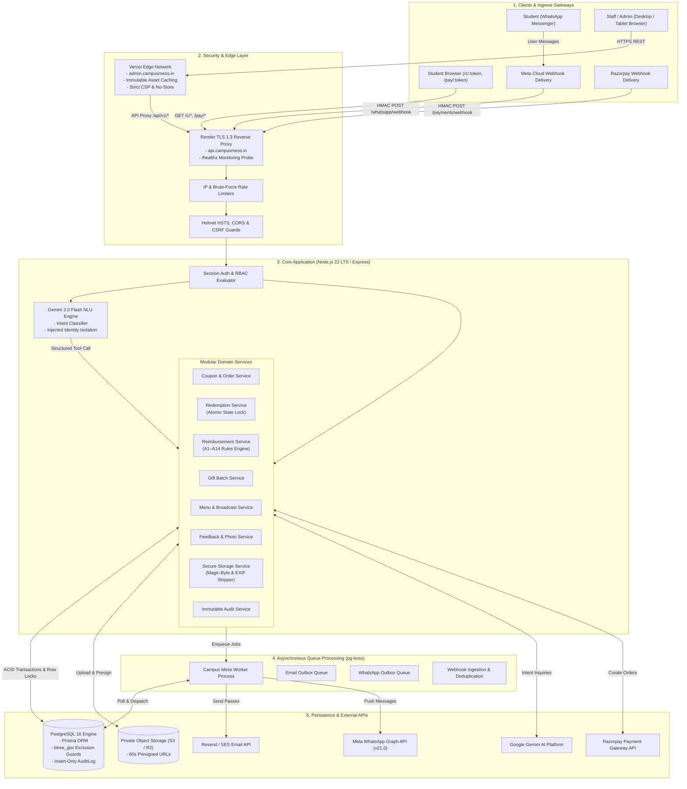
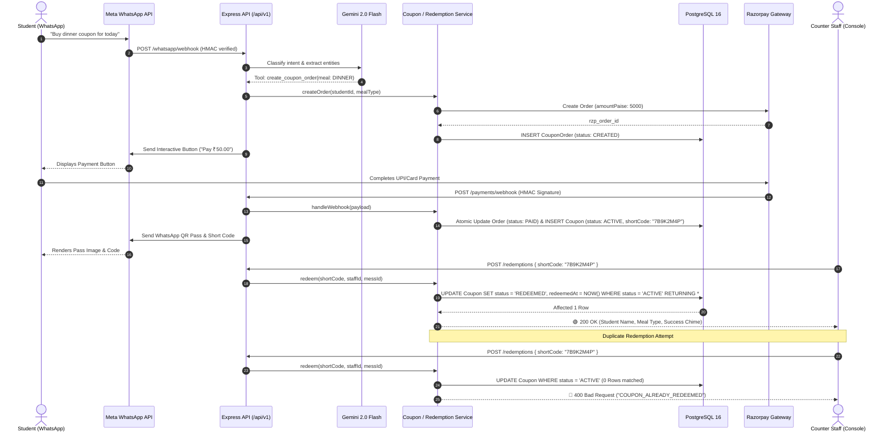
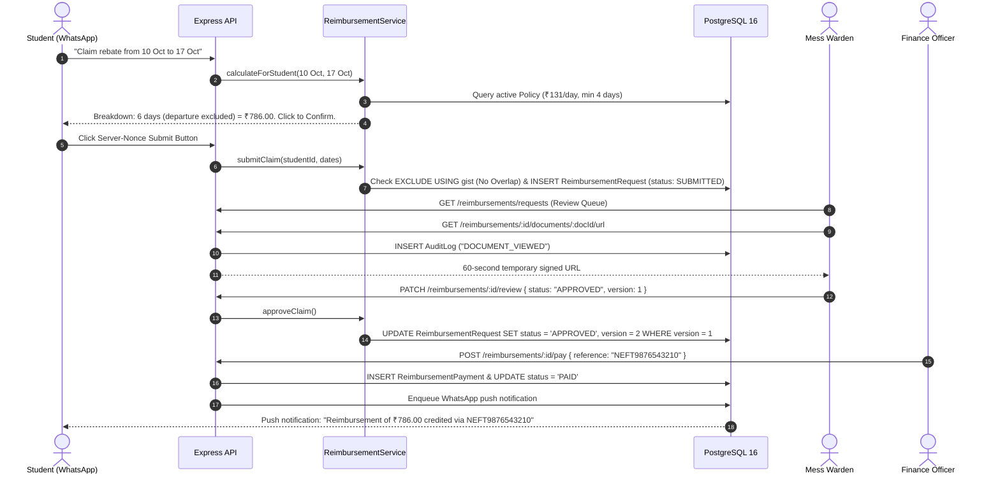
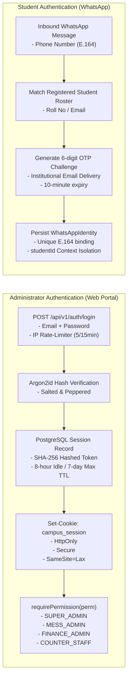
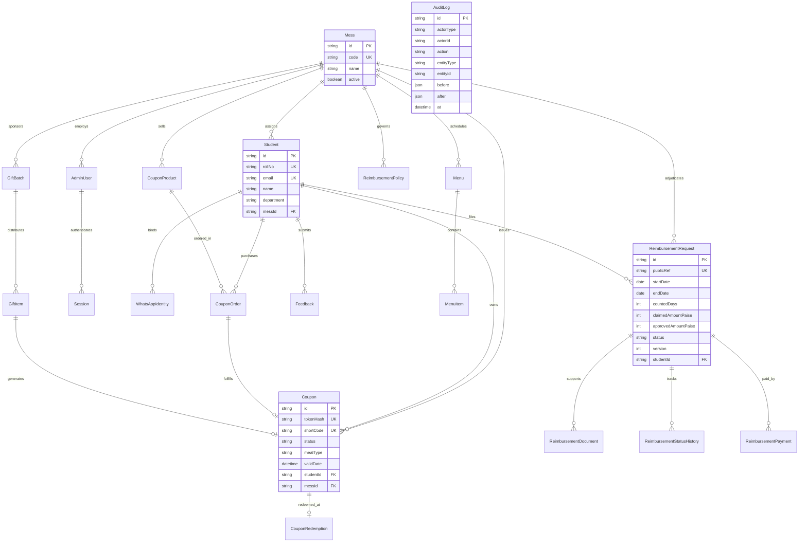
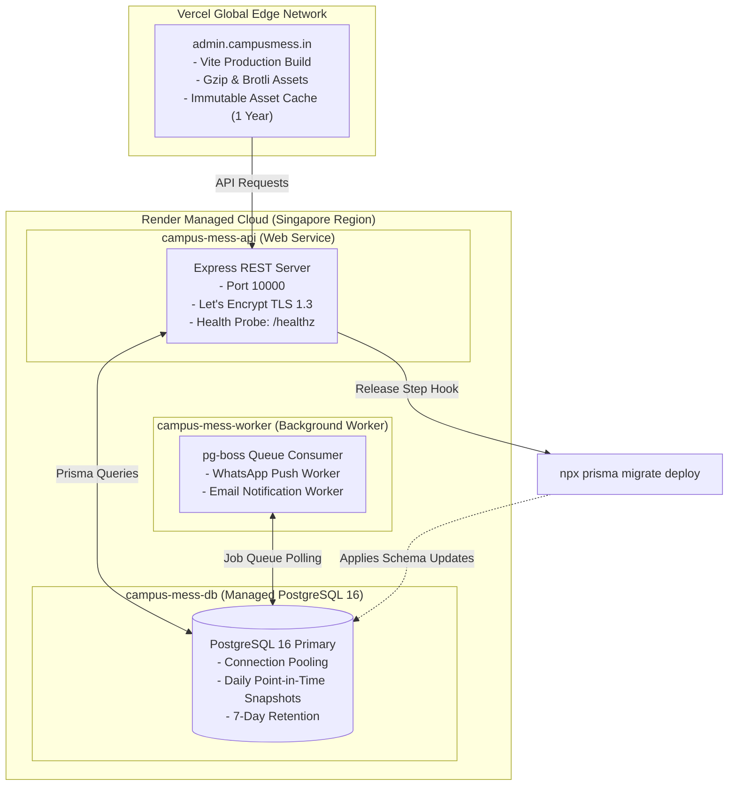

# Campus Mess System — System Architecture Documentation

**Version:** 1.1.0  
**Status:** Production Ready  
**Date:** 2026-11-01

---

## 1. High-Level Architecture Overview

The **Campus Mess System** is architected as an enterprise-grade **Modular Monolith** designed for high throughput, sub-50ms counter redemptions, strict financial non-repudiation, and seamless conversational dining interactions.

It serves two primary consumer channels:

1. **Student Channel (WhatsApp + Public Pass Web):** Conversational AI interface powered by the **Meta WhatsApp Cloud API** and **Google Gemini 2.0 Flash**, coupled with token-gated public checkout (`/pay/:orderToken`) and coupon pass display (`/c/:couponToken`).
2. **Operations & Administrative Channel (React Web SPA):** Role-Based Access Control console for wardens, mess caterers, counter attendants, and finance officers.

---

## 2. Frontend → Backend → Database Data Flow

### 2.1 Student Extra-Meal Coupon Purchase & Real-Time Redemption Flow

This end-to-end sequence illustrates how a student purchases a coupon via WhatsApp, fulfills payment, and redeems it at the dining hall entrance with zero-double-redemption guarantees:

### 2.2 Student Absence Reimbursement Lifecycle Flow

---

## 3. Authentication & Authorization Architecture

The platform separates administrator credentials from conversational student identities to maintain maximum security:

### 3.1 Administrator Session Security

- **Hashing:** Admin passwords use **Argon2id** (`argon2.hash`).
- **Session Tokens:** Transmitted via HTTP-only, Secure, SameSite=Lax cookies. Session IDs are cryptographically hashed using SHA-256 before persisting in the `Session` table.
- **CSRF Defense:** Mutating routes (`POST`, `PATCH`, `DELETE`) require the custom header `X-Requested-With: XMLHttpRequest` alongside strict Origin/Referer header verification against `FRONTEND_URL`.
- **Cross-Mess IDOR Boundaries:** Scoped admins (`MESS_ADMIN`, `COUNTER_STAFF`) have `actorMessId` validated at both the controller parameter boundary and inside the domain service. Attempting to view documents or mutate claims belonging to another mess throws a `ForbiddenError` (HTTP 403).

### 3.2 Student Identity & Context Isolation

- Students do not use passwords. Instead, their E.164 phone number is permanently verified via institutional email OTP.
- **Prompt Injection Defense:** The `studentId` and `messId` are derived securely from server session context and **never passed as LLM arguments**. Gemini cannot access or mutate balances of other students.

---

## 4. Key APIs, Modules, & Responsibilities

The codebase follows a clean modular monolith structure under [`backend/src/modules`](file:///d:/web%20development/coupon-app/backend/src/modules):

| Module               | Core Responsibilities                                                                                                               | Key Endpoints                                                                                               |
| -------------------- | ----------------------------------------------------------------------------------------------------------------------------------- | ----------------------------------------------------------------------------------------------------------- |
| **`auth`**           | Admin authentication, password hashing, session issuance, and RBAC permission evaluation.                                           | `POST /auth/login`, `POST /auth/logout`, `GET /auth/me`                                                     |
| **`coupons`**        | Extra-meal product pricing, Razorpay order provisioning, Crockford short code generation, token hashing.                            | `GET /coupons/products`, `POST /coupons/orders`, `GET /c/:token`                                            |
| **`redemptions`**    | High-speed counter scanning, coupon status verification, meal-window validation, and atomic redemption transitions.                 | `POST /redemptions/lookup`, `POST /redemptions`, `GET /redemptions/summary`                                 |
| **`reimbursements`** | Mathematical policy calculator (A1–A14), draft claim submissions, optimistic concurrency reviews, and payment logging.              | `GET /reimbursements/calculate`, `POST /reimbursements/submit`, `PATCH /reimbursements/requests/:id/review` |
| **`gifts`**          | Complimentary feast pass batch issuance, client-side idempotency deduplication, outbox multi-channel queueing, atomic revocations.  | `POST /gifts/batches`, `GET /gifts/batches/:id`, `POST /gifts/coupons/:id/revoke`                           |
| **`menus`**          | Meal slot scheduling (Breakfast, Lunch, Snacks, Dinner), dietary tagging, and emergency broadcast announcements.                    | `GET /menus/today`, `POST /menus`, `POST /menus/announcements`                                              |
| **`feedback`**       | Student meal ratings (1–5 stars), dietary category tags, WhatsApp photo attachments, and administrative review status.              | `POST /feedback`, `GET /feedback`                                                                           |
| **`whatsapp`**       | Meta webhook ingestion, raw body HMAC verification, deduplication, Gemini 2.0 Flash NLU, and conversational state routing.          | `GET /whatsapp/webhook`, `POST /whatsapp/webhook`                                                           |
| **`storage`**        | File upload validation (magic bytes, size ceilings, PDF script sanitization), private S3 key generation, and 60-second signed URLs. | `GET /reimbursements/:id/documents/:docId/url`                                                              |
| **`audit`**          | Non-repudiation audit trail recording every state change, document access, administrative login, and revocation.                    | `GET /audit`                                                                                                |

---

## 5. Database & Entity Relationship Model

The schema uses **PostgreSQL 16** with strict foreign keys, cascade protections, and index tuning:

---

## 6. External Services Integration

| Service                        | Protocol / Transport               | Purpose in System                                                                | Security & Verification                                                                          |
| ------------------------------ | ---------------------------------- | -------------------------------------------------------------------------------- | ------------------------------------------------------------------------------------------------ |
| **Meta WhatsApp Cloud API**    | HTTPS / Webhooks (Graph API v21.0) | Interactive student chat, meal pass delivery, status notifications.              | HMAC SHA-256 signature verification (`X-Hub-Signature-256`) using `crypto.timingSafeEqual`.      |
| **Google Gemini 2.0 Flash**    | REST SDK (`@google/genai`)         | Natural language understanding, intent classification, and entity extraction.    | Server-injected identity isolation; zero access to financial balance tools.                      |
| **Razorpay Payment Gateway**   | HTTPS / Webhooks                   | Processing online student payments for extra-meal coupons.                       | Raw-body HMAC verification (`X-Razorpay-Signature`), unique event deduplication (`P2002`).       |
| **Resend / Amazon SES**        | HTTPS REST / SMTP                  | Dispatching complimentary feast passes to student campus emails.                 | SPF, 2048-bit DKIM, and DMARC enforcement. Bounce webhook ingestion.                             |
| **S3 / Cloudflare R2 Storage** | AWS S3 SDK v3                      | Encrypted object storage for medical certificates and meal feedback images.      | Private bucket; randomized UUID keys; 60-second temporary presigned URLs; magic-byte validation. |
| **PostgreSQL `pg-boss`**       | PostgreSQL Native                  | Background transactional queue for outbox email dispatch and push notifications. | ACID-compliant outbox pattern; no Redis infrastructure required; exponential backoff retries.    |

---

## 7. Deployment Architecture & Production Components

The production deployment decouples edge delivery from computational backend workloads:

### Production Resilience Guarantees:

1. **Automated Migration Release Step:** Prior to routing live traffic to updated containers, Render runs `prisma migrate deploy`. If a migration fails, the deployment aborts without downtime.
2. **Graceful Worker Shutdown:** Background workers trap `SIGTERM` and allow in-flight email and WhatsApp deliveries up to 10 seconds to finish before exiting.
3. **Database Backup & Restoration Drills:** Managed PostgreSQL automated snapshots combined with off-site automated gzip SQL dumps via [`scripts/db-backup.sh`](file:///d:/web%20development/coupon-app/scripts/db-backup.sh).
4. **Post-Deployment Verification:** Automated smoke testing via [`scripts/smoke-test.ts`](file:///d:/web%20development/coupon-app/scripts/smoke-test.ts) validates perimeter headers, healthcheck endpoints, and 404 error envelopes after every release.
